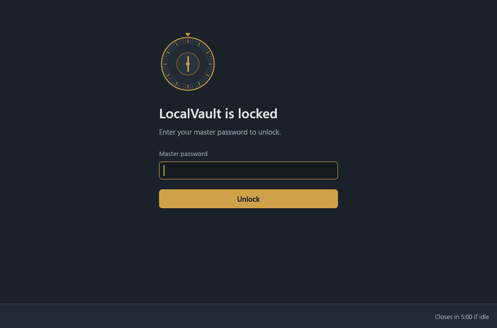
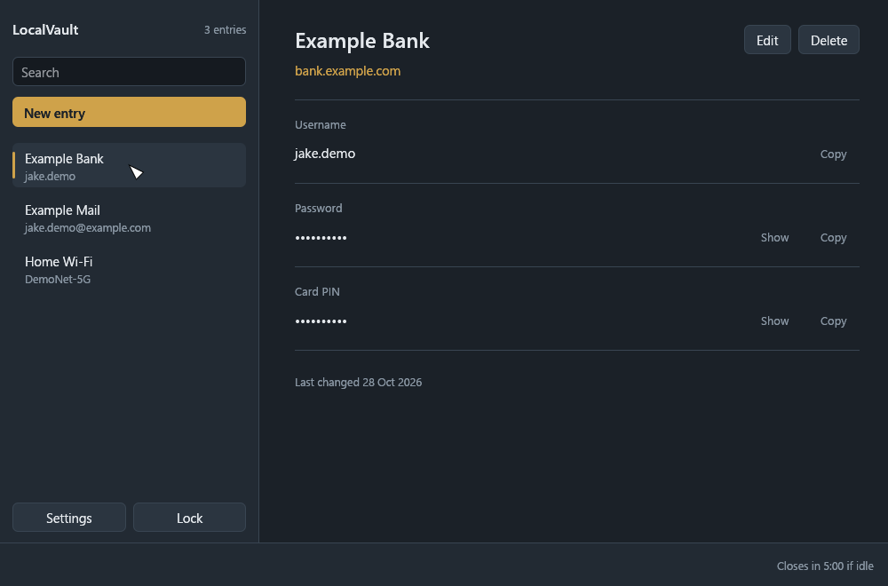
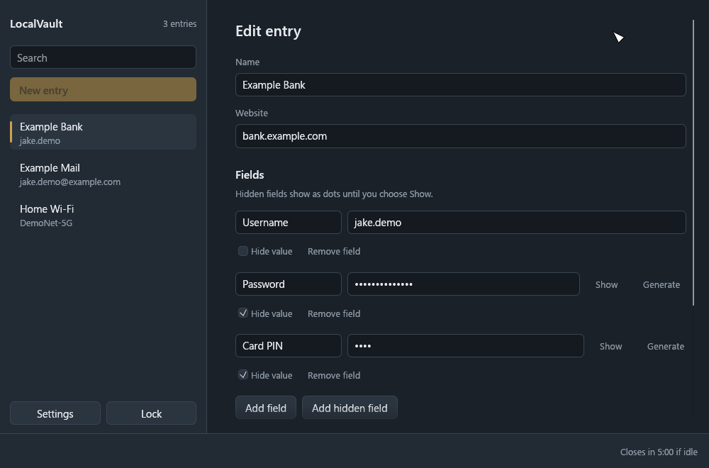
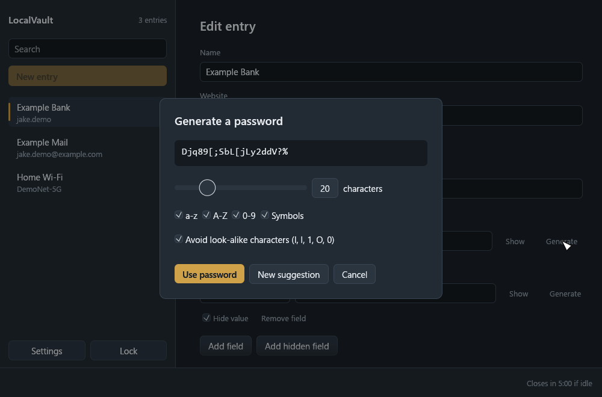
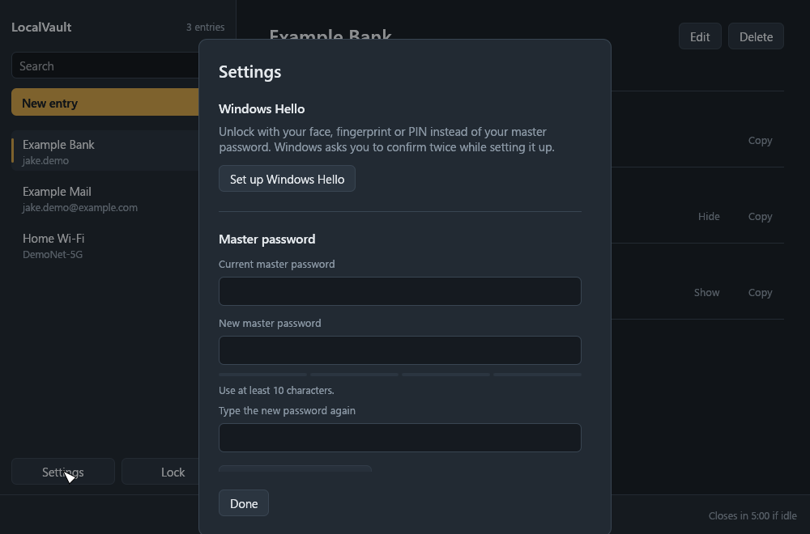

# LocalVault

A password vault for Windows 10 and 11 that keeps everything on your own PC. No account, no cloud, no network access. One exe and one encrypted file.



## What it does

- Stores logins as entries. Every entry starts with a username and a password, and you can add as many extra fields as you like (PIN, security answer, recovery code). Any field can be marked as hidden.
- Hidden values show as dots until you choose **Show**. **Copy** puts a value on the clipboard, asks Windows to keep it out of clipboard history and cloud clipboard, and clears it again after 30 seconds if it is still there.
- Unlocks with your master password, or with Windows Hello (face, fingerprint or PIN) once you set it up. The master password always keeps working as a backup.
- Locks every time it closes, and closes itself after 5 minutes without mouse or keyboard input.
- Built-in password generator.

| | |
|---|---|
|  |  |
|  |  |

## First run on a new PC

1. Put `LocalVault.exe` in a folder you can write to, for example `Documents\LocalVault`.
2. Start it. With no vault in that folder it asks you to create one: choose a master password (at least 10 characters) and type it twice.
3. Optionally choose **Set up Windows Hello** (also in **Settings**). Windows asks you to confirm twice.

The vault is saved as `LocalVault.vault` next to the exe, with the previous version kept as `LocalVault.bak`. Back up by copying the `.vault` file; the copy stays encrypted.

**There is no password reset.** If you forget the master password and have no working Windows Hello on that PC, the vault cannot be opened.

## How the encryption works

- A random 256-bit vault key encrypts all entries with **XChaCha20-Poly1305** (authenticated, so any tampering is detected).
- The vault key is stored only in sealed form:
  - **Password slot:** sealed with a key derived from your master password by **Argon2id** (256 MiB of memory, 3 passes, 4 lanes, random 16-byte salt). Every password guess costs an attacker the same work.
  - **Windows Hello slot (optional):** Windows Hello creates an RSA key in the TPM / Windows Hello container that never leaves this PC and can only be used after you pass Windows Hello. LocalVault has it sign a random challenge and turns the signature into the key for this slot. Copying the vault file to another PC does not carry this slot's key with it.
- Nothing about your entries is readable in the file, including titles and field names.
- Saves are atomic (write to a temporary file, then swap in) so a crash never leaves a half-written vault.
- Secrets are wiped from memory when the vault locks, as far as the UI toolkit allows. Text shown on screen briefly passes through buffers that cannot be wiped.

## Building

Needs the Rust toolchain (MSVC) and the Visual Studio C++ Build Tools.

```bash
cargo build --release
```

The exe is `target/release/localvault.exe`. Settings such as the auto-close time are constants at the top of `src/main.rs`.

## Tests

```bash
cargo test
```

Unit tests cover the crypto, the vault file format (wrong password, tampering, no plaintext on disk, password change, Windows Hello slot) and the password generator. `app::ui_tests::full_user_flow` drives the real UI offscreen: creates a vault, adds an entry, reveals and generates passwords, locks, rejects a wrong password and unlocks again.

Two ignored helpers create a demo vault and the screenshots in `docs/screenshots`:

```bash
cargo test make_demo_vault -- --ignored
```

```bash
cargo test screens_from_demo_vault -- --ignored
```

## Troubleshooting

During development on a PC running Kaspersky, test builds that save vaults were repeatedly frozen (every thread suspended) shortly after writing. Saving a vault means writing encrypted data and replacing a file, which antivirus behaviour monitoring can treat as suspicious. If LocalVault stops responding when it saves, check your antivirus reports and allow `LocalVault.exe` there.
